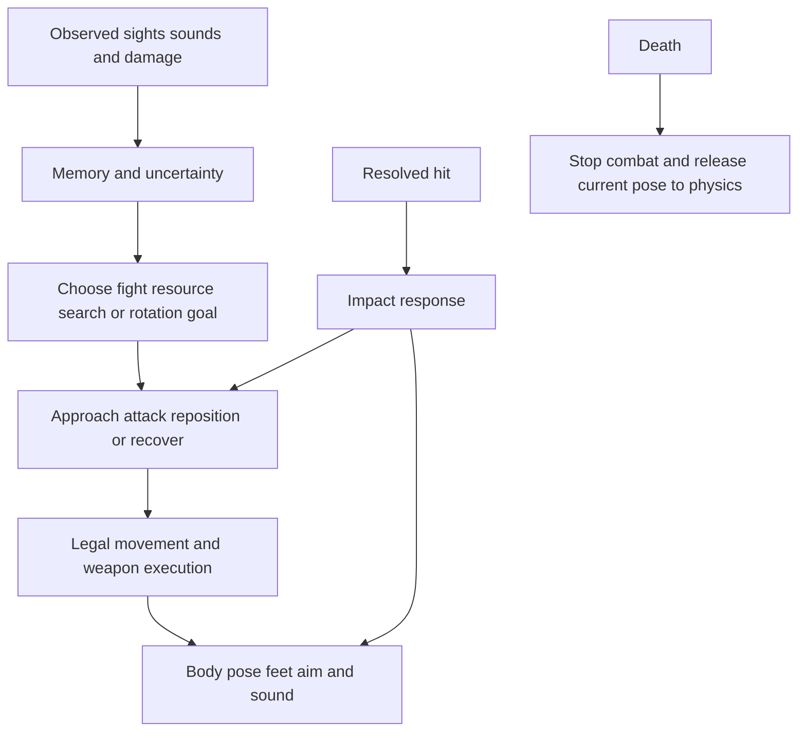

# Multiplayer bot behavior and satisfying combat in Fragony

Research and design brief, November 2, 2026.

This is the pre-implementation research snapshot. See [Dynamic combat implementation](dynamic-combat.md) for the implemented mechanisms and tuning.

Fragony should have opponents with recognizable intentions, credible limitations, and bodies that visibly respond to the player's shots. The most promising direction combines arena-bot decision making with expressive enemy animation: opponents compete for position and resources, commit to readable attacks, get disrupted by meaningful impacts, and recover in ways the player can exploit.

The goal is a fight the player can influence, with changing advantage and meaningful responses. A satisfying sequence might be: spot an opponent setting up a precision shot, pressure it out of position, land a heavy hit that breaks its brace, follow its retreat, and have it switch weapons to contest your pursuit before its final physical collapse. Each event should have a cause the player can recognize. Dynamic exchanges are the priority; distinct opponent personalities are optional tuning rather than a core milestone.

This brief covers multiplayer-style bots for the current single-player free-for-all. The competitive examples below are distinguished from cooperative or campaign enemies. Proposed timings and mechanisms are starting hypotheses for Fragony, not measured industry standards. This research included primary papers, developer presentations, published session descriptions, and current source inspection; it did not include playing or frame-analyzing the reference games. Session descriptions support only their stated scope.

## What other games demonstrate

### Quake III Arena gives opponents reasons to traverse the map

J. M. P. van Waveren's implementation thesis separates longer-term goals from nearby opportunities. Bots can collect useful items while following a larger objective, fight, retreat toward resources, chase a last-seen position, or temporarily hold an advantageous location. Item and weapon preferences depend on context and character weights. The thesis also documents distinct reaction and aiming parameters. See chapters 8–11 and 15 of [The Quake III Arena Bot](https://www.jmeiners.com/shamans/papers/ai/quake_3_arena_bot.pdf).

**Application to Fragony:** preserve a destination while evaluating useful detours along its actual route. A health trail should help explain movement through the arena. A bot should sometimes concede a fight to improve its next fight. Resource competition can create encounters without ordering every bot to seek the player.

**Avoid copying blindly:** the thesis includes high-skill prediction options that would conflict with Fragony's current fairness expectations. Its existence does not justify tracking unseen actors precisely.

### Unreal Tournament connects weapon choice to movement

Epic's original postmortem describes bots understanding weapon advantages and disadvantages, illustrating a bot closing distance for the Flak Cannon. See printed page 56 in [Game Developer, May 2000](https://media.gdcvault.com/GD_Mag_Archives/GDM_May_2000.pdf). Separately, Steve Polge describes UT3 bots comparing routes by risk and learning dangerous areas through path costs in this [developer interview](https://www.theguardian.com/technology/gamesblog/2008/jan/30/unrealtournament3interview).

**Application:** choosing a shotgun should alter the approach route and exposure tolerance. A rocket carrier should seek useful splash angles while maintaining separation. A marksman should value a firing position and an exit. Merely changing the equipped model and preferred distance will produce much less recognizable behavior.

### Counter-Strike treats attention and imperfection as systems

Michael Booth's slides describe independent viewing and movement, attention to approach points and sounds, uncertain sound locations, spring-and-damper view control, periodically changing aim offsets, and danger costs in navigation. Weapon proficiency includes contextual bursts and switching to a sidearm. Difficulty combines reaction, aim, attack delay, and proficiency. See slides 12–20 and 27–28 in [The Making of the Official Counter-Strike Bot](https://media.gdcvault.com/gdc04/slides/making_of_official.pdf).

**Application:** make an opponent's misses coherent. Its aim can lag a reversal, settle into a burst, then need to reacquire after a sudden change. Head and weapon attention should reveal what it is investigating. A miss can communicate an opponent's limitation; independent random spread communicates much less.

**Boundary:** Counter-Strike's deliberate caution and lethal sightlines should not slow this arena game into prolonged corner waiting.

### Halo Infinite varies capabilities as well as accuracy

The official July 2021 preview describes stronger bots dodging grenades and rockets, bots using equipment and tracking power-weapon spawns, and an anecdote in which a bot pursues a retreating player. These are developer descriptions, not controlled behavioral measurements. See [Inside Infinite, July 2021](https://www.halowaypoint.com/news/inside-infinite-july-2021).

**Application:** higher difficulty can improve when to pursue, which route to take, and whether to exploit an opening. Keep weapon damage and readable warning windows stable. Raise execution competence within limits rather than flattening all reaction delays or increasing health.

### Guerrilla's multiplayer study shows why strategic competence is insufficient

Tim Verweij's 2007 thesis proposes faction, group, and individual layers and evaluates a Capture and Hold implementation. Almost all respondents noticed coordination, yet many still judged the bots robotic. Reported weaknesses included ignoring immediate threats, limited cover reactions, and identical movement routes. This was research during Killzone 2 development; it is not a definitive specification of the released game's bots. See evaluation and future work, PDF pages 49–50 and 57–60, in [A hierarchically layered multiplayer bot system](https://www.guerrilla-games.com/media/News/Files/VUA07_Verweij_Hierarchically-Layered-MP-Bot_System.pdf).

**Application:** a long-term goal must allow an immediate survival response. A bot that walks through bullets to complete a clever objective will look foolish. Repeated identical routes undermine apparent intelligence even if the strategy is sound.

**Mode boundary:** Fragony's opponents are rivals. A shared squad commander coordinating them against the player would change the meaning of its free-for-all.

### F.E.A.R. gets complex-looking combat from simpler interactions

Jeff Orkin describes individual planning, simple squad behaviors such as moving to cover and advancing under covering fire, and situational communication. He explicitly states that complex squad behaviors were not implemented: some apparent flanks emerged from moving to valid cover via available routes. See pages 13–15 in [Three States and a Plan](https://www.gamedevs.org/uploads/three-states-plan-ai-of-fear.pdf).

**Application:** invest in good local positions, valid transitions, and observable consequences before building an elaborate planner. A believable flank can emerge because a bot wants a better engagement, provided the route actually changes the angle. In an FFA, that is an individual decision, not cooperation among all enemies.

### Left 4 Dead separates acting, movement, vision, and the body

Valve's presentation gives locomotion, body animation, vision, and intention separate responsibilities. Actions can start, suspend, resume, and finish, with explicit transition reasons. Its Director separately creates intensity peaks and recovery periods by changing threat populations; the slides distinguish pacing from difficulty. See slides 38–43 and 78–92 in [The AI Systems of Left 4 Dead](https://cdn.fastly.steamstatic.com/apps/valve/2009/ai_systems_of_l4d_mike_booth.pdf).

**Application:** let a dodge temporarily interrupt an attack without erasing the strategic goal. Keep physics responsible for legal movement and let animation express the result. Record why an action changed so behavioral failures can be explained.

**Mode boundary:** dynamically removing competitors or making them collectively spare the player would weaken FFA credibility. Encourage encounter rhythm through routes, resources, recovery, and individual decisions first.

### DOOM and Team Fortress 2 connect visual performance to gameplay

Jake Campbell's [DOOM AI and full-body-animation session description](https://www.gdcvault.com/play/1024186/Bringing-Hell-to-Life-AI) explicitly connects character success to expressive animation and flexible animation control. It does not establish a particular stagger, attack-token, or hit-reaction algorithm.

Valve's [Connecting Visuals to Gameplay](https://cdn.fastly.steamstatic.com/apps/valve/2008/MIGS08_ConnectingVisualsToGameplay.pdf), especially slides 15–18, emphasizes silhouettes and identifying characters on the first read.

**Application:** read intent from a brief glimpse: lowered shoulders while closing, a settled weapon before a precision shot, a compressed landing, an arm displaced by impact. Keep the dummy's silhouette and center of mass readable at normal engagement distances. More animation detail is useful only when it survives distance, motion, and visual clutter.

### Learning agents show possibility rather than a production requirement

[EA SEED's Battlefield 1 experiment](https://www.ea.com/seed/news/self-learning-agents-play-bf1) explores learning the basics of the game. [DeepMind's Quake III Capture the Flag work](https://deepmind.google/blog/capture-the-flag-the-emergence-of-complex-cooperative-agents/) demonstrates learned cooperation and strong performance with human-comparable reaction times, using populations and multiple behavioral timescales.

**Application:** test against varied opponents and distinguish strategic commitment from immediate control. These research results do not establish that trained policies will produce more satisfying Fragony enemies. A compact authored system is easier to inspect, tune, and connect to animation with this game's current scope.

## What Fragony already has

The current source includes much of the necessary foundation:

| Area | Present implementation | Opportunity |
| --- | --- | --- |
| Perception | Field of view, sight checks, hearing search positions, expiring memory | Uncertainty, recognition, and consistency between body attention and permitted knowledge |
| Combat | Reaction delay, aim smoothing, bursts, reloads, two persistent weapon magazines | Coherent aiming error, intentional combat sequences, clearer recovery opportunities |
| Positioning | Engage, flank, rotate, retreat, heal and search goals; height preference | Route exposure and genuine angle improvement rather than endpoint labels |
| Movement | Supported paths, stairs, pads, lifts, swimming, delayed projectile dodges | Acceleration, context-driven direction changes, safer dodge endpoint evaluation |
| Body | Procedural limb IK, world-planted feet, recoil/reload/crouch poses | Independent pelvis and aim orientation; starts, stops, reversals and recovery steps |
| Impacts | Regional directional flinch; damage cues and hit sounds | Weapon-specific response shapes, local direction, bounded mechanical disruption |
| Death | Joint-velocity inheritance, constrained ragdoll, collision and lethal/post-death shattering | Better impact-location expression and carefully bounded variation |

Code basis: `dist/ai.js`, `dist/characters.js`, `dist/game.js`, and `dist/pickups.js`. Existing AI and character tests passed during this research. Those tests establish functional behavior; they do not establish how enjoyable it feels.

Specific limitations visible in the source:

1. Strafe direction alternates on a randomized timer rather than selecting a new movement leg from cover, exposure, weapon phase, and observed threats. Movement has committed legs, but the choice to reverse is still largely periodic.
2. The whole character group rotates with `brain.facing`. Legs adapt to relative travel, but the pelvis and upper-body attention do not have independent directional control.
3. Live hits use a shared 170 ms sine flinch, scaled mainly by resolved damage and capped at 0.24 strength. The body returns to its prior task without a dedicated balance-recovery action.
4. The hit-direction vector is world-space, while torso roll directly consumes its x component. Equivalent impacts against differently rotated bots may therefore express differently. This needs a controlled rotation comparison before changing it.
5. Pickup and combat-position scoring primarily evaluate straight-line distance and destination properties. A destination hidden from a threat does not prove that reaching it is safe or that it provides a useful new firing angle.
6. Pickups expose their current availability globally. Rotation crowding also reads other brains' destinations. These are useful game-design shortcuts but exceed the local perception model used for targeting.
7. The soft limit of two bots selecting the player is deliberate player favoritism. It should be evaluated explicitly rather than treated as authentic FFA symmetry.
8. A decision probe confirms a healthy bot selects rotation over a nearby 5-health fragment or four-fragment line, while selecting a major pickup. Fragments can provide overhealth; this is a policy limitation, not an inherently worthless resource.

## Proposed behavior design

### Make plans coherent and interruptible

Use three decision timescales. Strategy selects a useful destination or engagement. A combat action determines how to execute it. Immediate reactions handle a perceived projectile, significant hit, blocked movement, or death. These layers should share explicit state rather than repeatedly infer intent from timers.

The action needs entry conditions, a reason to continue, completion conditions, and interrupt rules. A heavy hit can cancel a precision brace; ordinary impacts should not wipe a route. A projectile dodge must check support, blast exposure and collision before committing. If every dodge destination is worse, a bot should choose the least dangerous legal response or fail naturally.

### Let the fight change an opponent's tactics

Give every bot a shared repertoire of useful actions. Its current weapons, observed threats, health, ammunition, support and available routes determine which action fits. The same opponent can press an opening, lose the advantage, retreat, and turn to contest a pursuit within one encounter. Existing profiles may gently bias choices, but must not lock bots into roles.

| Situation change | Useful response | Player influence | Animation emphasis |
| --- | --- | --- | --- |
| An observed target retreats or breaks off to reload | Pursue if the route and current weapon support it; reacquire after sight loss | Bait pursuit, escape, or punish overcommitment | Forward travel followed by clear braking into fire |
| Direct fire makes the current angle costly | Break sight, take another angle, or disengage | Pressure can move the enemy rather than only remove health | Weight transfer, weapon retained toward the known threat within joint limits |
| Range changes beyond the equipped weapon's strength | Switch within the rolled pair or move to restore a useful range | Close on a precision weapon or open distance against a shotgun | Visible equip delay and a corresponding change of movement |
| Heavy impact interrupts a committed attack | Bounded recovery, then reassess whether to resume, reposition or retreat | A strong hit creates a short opening | Local impact, balance recovery, and truthful attack interruption |
| Ammunition runs out or another rival enters view | Seek a viable reload opening, switch weapons, or reprioritize the immediate threat | Exploit downtime or the attention shift | Clear reload/equip state and readable attention change |

Variation should follow meaningful changes in evidence rather than arbitrary action switching. Use commitment and switching thresholds to prevent indecision; allow urgent events to interrupt them. A dynamic fight does not require constant motion: a held angle or brief pause can create anticipation when it has a tactical reason and a readable ending. Never infer a hidden reload from player input; pursuit must rely on available visual or audible evidence.

### Choose routes that support the next fight

For a small set of candidates, estimate useful destination value minus travel time, exposed route time, known danger, and interruption cost. Include resource gain along the route. Normalize these terms before assigning weights so meters, seconds, and health do not compete arbitrarily.

Calculate detour cost as route-to-item plus item-to-goal minus route-to-goal. A small fragment with negligible detour can be worthwhile even when it is not worth replacing the strategic goal. Stop chaining fragments when they delay an imminent fight or dangerous crossing beyond the bot's tolerance.

A flank should improve the expected attack angle or bypass currently observed cover. Validate the route and likely reappearance point. Keep last-seen pursuit approximate, recheck sight before shooting, and abandon a search when the evidence expires. Pickup respawn estimates should derive from observed collection or known rules, not an omniscient timer unless that advantage is explicitly intended.

### Build fair aim from acquisition and tracking

Keep acquisition delay separate from tracking quality. Add an aim offset that evolves smoothly over a burst, angular acceleration limits, and a temporary tracking penalty after a target reversal or interrupted brace. Keep projectile leading bounded by observed velocity and stale it after sight loss.

Evaluate horizontal tracking, vertical tracking, target changes, and reacquisition independently. A low accuracy number can still produce unpleasant surprise hits. Do not guarantee an initial miss: the opening should be fair because the bot needs time and a valid aim solution, not because the first bullet secretly cannot hit.

### Adapt from observations

A bot can remember that an observed route recently hurt it, that a target's last observed weapon favors close range, or that a contested pickup is unlikely to be safe. Decay those beliefs. Do not read the player's current hidden health, reload input, or through-wall position to manufacture a clever response.

Start with bounded changes within a life. Only add persistent across-respawn learning if it remains understandable and does not turn into a vendetta shared by every opponent. Keep difficulty stable during a fight so successful play continues to work.

## Proposed animation and impact design

### Give the living body weight

The current procedural rig is suitable for this art direction. Extend it with an authored library of short poses and curves layered over movement and IK. Motion matching or a large motion-capture library is not a prerequisite.

Separate travel, pelvis, chest, head, and weapon orientation within joint limits. Let head and weapon lead attention slightly; let the pelvis follow with a stepping turn. Use actual movement displacement for foot cadence. On a reversal, brake, transfer weight, and push off rather than visually swapping direction without preparation.

Prioritize these transitions: idle to move, move to stop, lateral reversal, large turn, landing, brace to fire, impact to recovery, and living pose to death. Preserve a trackable torso and head. Dramatic head swaying on every footstep would make ordinary aiming unnecessarily frustrating.

### Make a shot feel like contact with a physical object

Resolve damage once, then create one impact event containing shot identity, hit regions, point, direction, effective damage, weapon impulse class, and lethality. Aggregate a shotgun's pellets for its main body response; retain individual regions for damage accounting. This prevents a single trigger pull from restarting the same reaction repeatedly.

Express impact direction in the bot's local frame and use the contact point's offset from the body to shape rotation. Separate visual impulse from damage. A quick small-amplitude response can feel sharp; a larger slower response can feel heavy without granting extra damage or launching the character.

| Player weapon | Proposed live reaction | Proposed lethal expression |
| --- | --- | --- |
| Nailer | Sharp local snap, shoulder displacement, brief upper-body recovery | Contact-biased collapse with restrained impulse |
| Automatic rifle | Distinct small hits, with bounded accumulated body tension | Current running/turning momentum remains visible |
| SMG | Rapid local vibration and shell feedback; infrequent major disruption | Collapse preserves travel rather than becoming a generic launch |
| Shotgun | One aggregate chest/shoulder compression; optional bounded recovery step at close range | Stronger directional release, with existing shattering rules |
| Rail | Narrow, crisp regional response with readable reset | Localized release consistent with a precise high-energy strike |
| Rocket or grenade | Blast-facing recoil or supported recovery step, scaled by exposure | Broader body impulse consistent with distance and obstruction |

These are initial artistic directions. Tune them against actual shot rhythm, range, and the small on-screen target size. Keep the dummy's hard shell and flexible joints as the material identity: brief shell chips, rubber-joint motion, mechanical clacks, and mass settling suit this game better than borrowing flesh effects.

### Distinguish flinch from stagger

A flinch visibly registers a hit while allowing continued movement or firing. A stagger briefly changes the bot's ability to act. This distinction should be explicit in the implementation and visible to the player.

As a first experiment, keep light reactions around 60–120 ms and heavy recovery around 180–300 ms of world time. Start with roughly 700–1000 ms between major staggers and a short decaying impulse accumulator. These values require playtesting; they are not source-derived targets. Lethal damage always wins immediately.

Every resolved hit still gets appropriate contact feedback during stagger recovery, but repeated light fire must not indefinitely renew a full-body interruption. Test whether heavy impacts should cancel a rail charge; that creates useful counterplay but also materially changes weapon balance. Keep ordinary reload progress unless a separately designed interruption rule says otherwise.

Do not make all heavy impacts throw the head away from a follow-up shot. Favor chest/shoulder motion and a bounded recovery step. Preserve support and world collision; an animation should not slide a living bot through cover or across an unsupported ledge.

### Preserve the existing death strengths

The current death solver already inherits velocity and the posed joints. Keep that continuity. Improve point and direction sensitivity before increasing force. Death must stop weapon fire and scoring immediately; subsequent corpse impacts should remain separate from live hit and kill confirmation.

Retain lethal/post-death-only limb shattering unless changing the game's identity deliberately. A living bot losing a functional limb would require new movement, aiming, damage, and readability rules. Ordinary nonlethal shell damage can communicate impact without creating that obligation.

### Keep sound and visual cues truthful

Use brief weapon preparation sounds, shell impact, weighty landing, and distinct death settling in the existing positional mix. Reserve the loudest confirmation for meaningful outcomes and avoid masking nearby steps. A visible brace must correspond to a real firing constraint; a recovery animation must correspond to the real recovery window. Otherwise players learn that the body's information cannot be trusted.

## How to evaluate the design

Keep mechanical correctness, observed behavior, and player experience separate. More kills do not demonstrate better enemies; more animation does not demonstrate clearer combat.

| Question | Measurement or review |
| --- | --- |
| Can players read intent? | Show short normal-speed clips without labels; ask whether the bot is searching, attacking, reloading, bracing, or recovering |
| Do shots feel connected? | Compare restrained and stronger reactions in matched encounters; ask about contact, weight, and follow-up tracking separately |
| Does the fight change meaningfully? | Review what caused each pursuit, disengagement, angle change, weapon switch and recovery; ask whether players could influence the exchange, and check for repetitive loops or arbitrary switching |
| Does aim feel fair? | Log acquisition-to-first-shot, angular error, LOS at firing, reversal tracking, and reacquisition; inspect distributions and clips |
| Do flanks work? | Measure changed engagement angle, reacquisition, actual damage after arrival, deaths en route, and abandoned attempts |
| Do escapes work? | Record LOS break, damage after break, survival window, healing gain, and subsequent re-engagement; distinguish censored lives |
| Does stagger dominate? | Measure maximum uninterrupted loss of control, rail cancellations, and SMG/rifle suppression at equal damage exposure |
| Does movement look physical? | Review feet and torso during stops, turns, stairs, lifts, swimming, pads, and landings at normal speed and slow motion |
| Does performance hold? | Measure frame-time percentiles on a recorded machine with all bots fighting; inspect animation, sensing, navigation and effects costs separately |

Reuse `research/flow/encounter-telemetry.mjs` and its existing observational-purity checks. Add action-transition reasons, perception evidence timestamps, observed versus actual pickup availability, aim traces, impact events, and recovery intervals. Preserve seeded randomness: observers must not consume random draws used by gameplay.

Use matched seeds, both maps, early and capped difficulty, all weapon classes, and moving combatants. Pair those simulations with human play. Automated health seeking or nominally correct foot positions cannot tell us whether a pursuit was exciting or a shotgun hit felt powerful. Do not extrapolate one successful seed into a general result.

## Recommended experiment order

1. **One opponent and two weapons.** Compare Nailer and SMG impacts on an identical moving duelist. Add local impact direction, distinct response envelopes, capped accumulation, and clear recovery. Review front/side/back hits at several body orientations. This isolates the central requirement: satisfying targets.
2. **One complete combat sequence.** Prototype acquire, attack, reposition, and recover with independent upper/lower orientation, weight transfer, and an interruptible brace. Compare against the current timed strafe baseline.
3. **Route and resource intent.** Add bounded fragment detours, exposure-aware position candidates, and meaningful flank validation. Use existing encounter telemetry to check that improvements survive full matches on both maps.
4. **Dynamic fights with multiple rivals.** Expand the shared actions across all five bots, preserving rolled weapon pairs and fair perception. Test changes of advantage, third-party interference, pursuit reversals and recovery under pressure. Distinct personalities remain optional.
5. **Difficulty and fairness review.** Tune competence independently from animation quality. Compare the current player-focus cap with alternatives in a controlled experiment before changing it; assess both perceived fairness and FFA credibility.

The first milestone should be a compelling short fight with one bot whose intention, hit response, recovery, and death all belong to the same performance. Once that works, extend it into five opponents competing across the arena. Runtime behavior and deployment were unchanged by this research.
